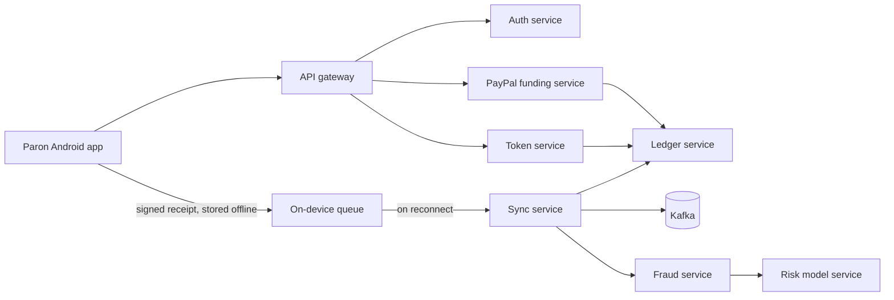

# Paron

**Offline payments from a native Android wallet, with PayPal Sandbox funding and AI-assisted risk review.**

Paron lets a customer reserve funds while online, receive a capped offline token, and make a signed payment when connectivity is unavailable. When the device reconnects, the backend verifies and evaluates the queued payment before settling it. The Android wallet can also start a PayPal Sandbox top-up; Paron’s backend creates and captures the PayPal order and credits the demo ledger.

**Public source repository:** [github.com/diyaj14/paron](https://github.com/diyaj14/paron)

**License:** MIT (OSI-approved), see [LICENSE](LICENSE).

**Primary experience:** native Android app. The browser demo is a companion walkthrough; its offline handoff is simulated.

## Hackathon demo links

Render free services can sleep; opening their health-check links wakes them. Wait for a successful health response before starting the end-to-end demo.

| App or service | Public URL | Wake/health check |
|---|---|---|
| Paron overview and browser demo | **WEBSITE URL NEEDED** | Open the URL; then choose **Experience Demo** |
| Android API gateway | [paron-api.onrender.com](https://paron-api.onrender.com) | [/actuator/health](https://paron-api.onrender.com/actuator/health) |
| Auth service | [paron-auth.onrender.com](https://paron-auth.onrender.com) | [/actuator/health](https://paron-auth.onrender.com/actuator/health) |
| Token service | [token-service-zwy4.onrender.com](https://token-service-zwy4.onrender.com) | [/actuator/health](https://token-service-zwy4.onrender.com/actuator/health) |
| Ledger service | [paron-8w2t.onrender.com](https://paron-8w2t.onrender.com) | [/actuator/health](https://paron-8w2t.onrender.com/actuator/health) |
| Sync service | [paron-sync.onrender.com](https://paron-sync.onrender.com) | [/actuator/health](https://paron-sync.onrender.com/actuator/health) |
| Fraud service | [paron-fraud.onrender.com](https://paron-fraud.onrender.com) | [/actuator/health](https://paron-fraud.onrender.com/actuator/health) |
| PayPal funding service | [paron-paypal-funding.onrender.com](https://paron-paypal-funding.onrender.com) | [/actuator/health](https://paron-paypal-funding.onrender.com/actuator/health) |
| Risk model | [paron-risk-model.onrender.com](https://paron-risk-model.onrender.com) | [/healthz](https://paron-risk-model.onrender.com/healthz) |

The Android app uses the API gateway URL. The browser demo is preconfigured with the API gateway and PayPal funding URLs above. Add the website's final public URL to this table and set both the API gateway and PayPal funding service `CORS_ALLOWED_ORIGINS` to that exact website origin.

### If a backend URL shows a 404 at `/`

That is expected for these API-only services: they do not serve a website at the root path. For example, a Spring Boot “Whitelabel Error Page” at the PayPal funding service root means `/` has no handler; it does not by itself mean the service failed to start. Open the health-check path in the table instead. PayPal order/config routes are API endpoints, and the funding routes require a valid Paron session; they are not browser homepages.

### If the browser demo says “Failed to fetch”

Open the API gateway and PayPal funding health checks first and wait for both to return a healthy response; Render may need time to wake a sleeping service. Then check that `DEFAULT_API_BASE` and `DEFAULT_FUNDING_BASE` in `pwa/public/src/app.js` match the deployed HTTPS URLs. In Render, set `CORS_ALLOWED_ORIGINS` on both the API gateway and PayPal funding service to the exact website origin (scheme and hostname only, with no path or trailing slash), for example `https://your-site.vercel.app`. Also confirm the gateway's `PAYPAL_FUNDING_SERVICE_URL` points to the funding service's reachable URL. Redeploy after changing environment variables. A 404 at `/` alone does not explain a browser “Failed to fetch”; a sleeping service, wrong URL, CORS rejection, or failed upstream connection can.


## Mobile app screenshots

Add Android screenshots to docs/screenshots/ and replace each placeholder below with an image. For example: ``

| Onboarding | Home |
|---|---|
| *Screenshot placeholder — docs/screenshots/onboarding.png* | *Screenshot placeholder — docs/screenshots/home.png* |

| Wallet and PayPal Sandbox | Offline payment |
|---|---|
| *Screenshot placeholder — docs/screenshots/wallet-paypal.png* | *Screenshot placeholder — docs/screenshots/offline-payment.png* |

| Payment history and sync | Risk review |
|---|---|
| *Screenshot placeholder — docs/screenshots/history-sync.png* | *Screenshot placeholder — docs/screenshots/risk-review.png* |

## What the app does

- Onboards a customer through the Android app and saves the profile through the backend.
- Reads the online balance and reserves funds for a capped offline token.
- Creates signed offline payment receipts on the device.
- Queues payments without a network connection and submits them to the backend after reconnecting.
- Verifies receipts and evaluates settlement risk using deterministic fraud rules and a versioned risk model.
- Starts PayPal Sandbox checkout from the Android wallet; the backend verifies the capture before crediting the demo ledger.

The customer-facing experience is the native Android app. PayPal may open its own approval page or app during checkout, then return to Paron. The PWA is not required for the app flow.

### Judge demo token access

The judge deployment permits an authenticated user to retrieve and use their one active offline token from another device so judges can install the APK on their own phones. This is a demo convenience, not a production security setting. Set `OFFLINE_TOKEN_DEVICE_BINDING_REQUIRED=true` in token-service to bind tokens to the issuing device before any real-money use.

## Android demo APK

[Download the Paron Android demo APK](https://github.com/diyaj14/paron/releases/download/demo-v0.1.0/Paron-demo.apk). After installing, open **Backend Server Address** in the wallet, enter the deployed Render API gateway URL, and tap **Apply Server URL**. This is a debug/demo build for Android 8.0 (API 26) and newer; it is not a production-signed app.

## License

Paron's original project code is available under the [MIT License](LICENSE). Third-party libraries, assets, and services remain subject to their respective licenses and terms.

## How a payment moves through Paron



The ledger is the component that reserves, credits, and settles balances. The risk model provides a score and reason contributions; deterministic rules and backend policy make the settlement decision.

## Services

| Service | Purpose |
|---|---|
| api-gateway | Android app entry point, session verification, routing, and rate limiting |
| auth-service | Demo OTP/session and customer profile |
| token-service | Issues and validates capped offline tokens |
| ledger-service | Stores balances and handles reservations, credits, and settlement |
| sync-service | Accepts queued receipts and coordinates settlement after reconnect |
| fraud-service | Applies fraud rules and uses the risk-model response in settlement review |
| paypal-funding-service | Creates PayPal Sandbox orders, verifies captures, and credits the demo ledger |
| risk-model-service | FastAPI service that loads the versioned risk model and returns a risk score |

Backend data is stored in PostgreSQL (the project is configured for Supabase). Kafka and Redis are used by the local backend stack and can be provided by hosted services for deployment.

## Tools, technologies, and sponsor integrations

| Area | Tools used |
|---|---|
| Customer Android app | Kotlin, Jetpack Compose, Android SDK |
| Backend APIs | Java, Spring Boot, Spring Cloud Gateway, Maven |
| Risk scoring | Python, FastAPI, scikit-learn, NumPy, joblib |
| Persistence and messaging | PostgreSQL via Supabase, Redis, Kafka |
| Local infrastructure | Docker Compose |
| Hosting | Render for backend services; the static companion website can be hosted on Render or Vercel |
| Payment sponsor integration | PayPal Orders API in Sandbox mode |
| API examples | `testing-guide.http` for the VS Code REST Client / IntelliJ HTTP Client |

PayPal and Render are the sponsor integrations used in this project.

## Run locally

### Prerequisites

- Android Studio with Android SDK 35
- Docker Compose
- JDK 26 for the backend
- Python and pip for the risk-model service
- Supabase/PostgreSQL, Redis, Kafka, and PayPal Sandbox credentials

### 1. Configure environment

From the repository root, create .env from .env.example and fill in the values for your development environment. Keep .env and private keys out of Git.

```powershell
Copy-Item .env.example .env
```

The backend uses the same Supabase database across several services. Some services have schema generation disabled, so use a database initialized with the project’s required tables.

### 2. Start local infrastructure

```powershell
docker compose up -d
```

This starts the local Kafka and Redis containers. PostgreSQL is configured separately through .env.

### 3. Start the risk model

In a separate terminal:

```powershell
Set-Location risk-model-service
python -m pip install -r requirements.txt
python -m uvicorn app.main:app --host 0.0.0.0 --port 8600
```

### 4. Build and start the backend

From the repository root:

```powershell
.mvnw.cmd -DskipTests package
.start-services.ps1
```

start-services.ps1 starts the seven Java services. Keep the risk-model terminal and Docker infrastructure running as well.

### 5. Run the Android app

Open OfflinePay-Kotlin-Wallet-App/native/offlinepay-android in Android Studio, let Gradle sync, and run the app configuration on an emulator or Android phone.

Set the gateway URL in the app:

- Android emulator: http://10.0.2.2:8080
- Physical phone on the same Wi-Fi: your computer’s LAN IP with port 8080
- Hosted backend: use the gateway’s HTTPS URL

For more detailed local setup notes, see [run-guide.md](run-guide.md) and the [Android app README](OfflinePay-Kotlin-Wallet-App/native/offlinepay-android/README.md).

## Two-device Android judge walkthrough

Use the **Paron wallet app on both devices** for the QR flow. The separate `merchant-android/` project is a Bluetooth receiver and merchant-balance viewer; it does not scan QR codes.

1. Start the backend using the local steps above, or point both Android installs at the deployed API gateway. For a local backend, use `http://10.0.2.2:8080` on the emulator and `http://<computer-LAN-IP>:8080` on a physical phone on the same Wi-Fi.
2. Sign in on the payer/emulator with phone `9876543210` and on the receiving phone with a different demo phone, such as `9876543211`. Use OTP `123456` on both. For Render, `DEMO_AUTH_PASSWORD` on auth-service must be `123456`.
3. On the payer, reserve an offline amount while online. Confirm the wallet displays that offline balance before proceeding. PayPal Sandbox top-up is optional when the demo wallet already has sufficient balance.
4. On the payer, open **Pay Offline**, enter an amount within the reserved limit, and create the signed payment QR. On the receiving phone, open **Pay with UPI → Scan QR Code** and scan it. Both phones can then be disconnected from the internet; QR scanning and local signature verification happen on-device.
5. Reconnect the receiving phone to sync the receipt. The backend validates the payer's token and signed receipt, applies fraud/risk checks, settles the payer's reserved funds, and credits the merchant ID carried in the receipt (the default is `merchant_canteen`). The receiver may sync automatically when connectivity returns.
6. To show the merchant's collected balance, open `merchant-android/` on the receiving phone, set Merchant ID to `merchant_canteen`, enter the same reachable gateway URL, and tap **Register & check balance (online)**.

Use two different demo phone numbers so the video shows a payer and a merchant-side receiver. The development OTP is public demo access, not real phone verification. Do not tap **Recover active token** on the receiving device; that action transfers the payer's token to that device.

The sync worker associates final transaction history with the payer identified by the token. The receiving wallet's local receipt may therefore still show pending after sync; use the merchant app's collected balance as evidence of merchant settlement.

The ledger service includes recovery for multiple stale active reservations left by earlier demo attempts. Rebuild/redeploy the updated ledger service before recording if reservation still reports `ACTIVE_RESERVATION_EXISTS`; wait for the payer app to show the reserved balance before filming the payment.

## PayPal Sandbox

Create a Sandbox app and buyer account in the [PayPal Developer Dashboard](https://developer.paypal.com/). The Android app and browser demo ask the Paron backend to create an order. The buyer approves it in PayPal Sandbox; the funding service then verifies and captures that same order server-side. Only after a completed capture does it credit the demo ledger. The PayPal client secret stays on the backend and is never shipped in the Android app or website.

The demo currently charges in USD and credits the INR test ledger using the configurable `PAYPAL_WALLET_CREDIT_RATE` (default `85.00`). This is a demo conversion rate, not a live exchange rate or a real payout to a merchant. Use Sandbox buyer credentials and test funds to exercise checkout.

If checkout reports `invalid_client` / `PAYPAL_CREDENTIALS_INVALID`, update the **PayPal funding backend** with the Client ID and Secret copied together from one PayPal **Sandbox REST app**, and set `PAYPAL_BASE_URL` to `https://api-m.sandbox.paypal.com`. Save and redeploy the Render funding service; for local development, update the matching entries in `.env` and restart it. Do not place the PayPal secret in Vercel or the Android app. See the [deployment troubleshooting steps](docs/deployguide.md#paypal-funding-paron-paypal-funding).

## AI risk model

The risk model service is configured to load a versioned calibrated logistic-regression model (`lr-calibrated-v2.0.0-scenario`). During receipt reconciliation, it scores transaction and velocity signals and returns a risk score, confidence, model version, and plain-language reason contributions. The fraud service combines that assessment with deterministic integrity and policy rules. Weak or unavailable model signals can result in a hold for review; the model does not move money or independently authorize a payment. The Render model service must be redeployed from the current Dockerfile with `MODEL_DIR=/app/artifacts/scenario-v2`; verify the reported model version at `/healthz` before claiming that the hosted demo uses v2.

The checked-in evaluation uses synthetic data (4,000 generated records, with 3,554 eligible for model scoring). Its metrics demonstrate the pipeline on generated scenarios; they are not claims about real-world fraud detection or production performance. See the [model evaluation report](docs/reports/phase2-evaluation.md), [scenario data card](docs/scenario-data-card.md), and [fraud drill](ml/fraud_drill.py).


**Demo video:** *Add public YouTube link here.*

**Android build:** *Add APK or release link here.*

## Repository map

```text
api-gateway/                 Spring Cloud Gateway
auth-service/                Demo authentication and profiles
token-service/               Offline token issuance and validation
ledger-service/              Balances, reservations, and settlements
sync-service/                Offline receipt sync and settlement
fraud-service/               Fraud rules and review policy
paypal-funding-service/      PayPal Sandbox order and capture
risk-model-service/          FastAPI risk model
ml/                          Synthetic data, evaluation, and fraud drill
merchant-android/            Merchant Android app
OfflinePay-Kotlin-Wallet-App/native/offlinepay-android/
                             Customer Paron Android app
docs/                        Architecture, reports, and demo material
```

## Documentation

- [Free Render deployment guide](deployguide.md)
- [Local run guide](run-guide.md)
- [Architecture](docs/architecture.md)
- [Two-phone demo](docs/two-phone-demo.md)
- [Risk evaluation](docs/reports/phase2-evaluation.md)
- [PayPal AI Hackathon pitch and criteria checklist](docs/pitch-video-script.md)
