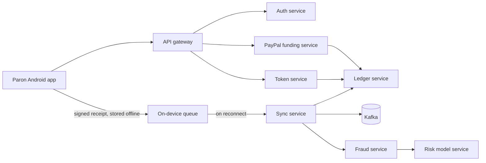

# Paron

**Offline payments from a native Android wallet, with PayPal Sandbox funding and AI-assisted risk review.**

Paron lets a customer reserve funds while online, receive a capped offline token, and make a signed payment when connectivity is unavailable. When the device reconnects, the backend verifies and evaluates the queued payment before settling it. The Android wallet can also start a PayPal Sandbox top-up; Paron’s backend creates and captures the PayPal order and credits the demo ledger.


## Mobile app screenshots

Add Android screenshots to docs/screenshots/ and replace each placeholder below with an image. For example: ``

| Onboarding | Home |
|---|---|
| *Screenshot placeholder — docs/screenshots/onboarding.png* | *Screenshot placeholder — docs/screenshots/home.png* |

| Wallet and PayPal Sandbox | Offline payment |
|---|---|
| *Screenshot placeholder — docs/screenshots/wallet-paypal.png* | *Screenshot placeholder — docs/screenshots/offline-payment.png* |

| Payment history and sync | Risk review |
|---|---|
| *Screenshot placeholder — docs/screenshots/history-sync.png* | *Screenshot placeholder — docs/screenshots/risk-review.png* |

## What the app does

- Onboards a customer through the Android app and saves the profile through the backend.
- Reads the online balance and reserves funds for a capped offline token.
- Creates signed offline payment receipts on the device.
- Queues payments without a network connection and submits them to the backend after reconnecting.
- Verifies receipts and evaluates settlement risk using deterministic fraud rules and a versioned risk model.
- Starts PayPal Sandbox checkout from the Android wallet; the backend verifies the capture before crediting the demo ledger.

The customer-facing experience is the native Android app. PayPal may open its own approval page or app during checkout, then return to Paron. The PWA is not required for the app flow.

## How a payment moves through Paron



The ledger is the component that reserves, credits, and settles balances. The risk model provides a score and reason contributions; deterministic rules and backend policy make the settlement decision.

## Services

| Service | Purpose |
|---|---|
| api-gateway | Android app entry point, session verification, routing, and rate limiting |
| auth-service | Demo OTP/session and customer profile |
| token-service | Issues and validates capped offline tokens |
| ledger-service | Stores balances and handles reservations, credits, and settlement |
| sync-service | Accepts queued receipts and coordinates settlement after reconnect |
| fraud-service | Applies fraud rules and uses the risk-model response in settlement review |
| paypal-funding-service | Creates PayPal Sandbox orders, verifies captures, and credits the demo ledger |
| risk-model-service | FastAPI service that loads the versioned risk model and returns a risk score |

Backend data is stored in PostgreSQL (the project is configured for Supabase). Kafka and Redis are used by the local backend stack and can be provided by hosted services for deployment.

## Run locally

### Prerequisites

- Android Studio with Android SDK 35
- Docker Compose
- JDK 26 for the backend
- Python and pip for the risk-model service
- Supabase/PostgreSQL, Redis, Kafka, and PayPal Sandbox credentials

### 1. Configure environment

From the repository root, create .env from .env.example and fill in the values for your development environment. Keep .env and private keys out of Git.

```powershell
Copy-Item .env.example .env
```

The backend uses the same Supabase database across several services. Some services have schema generation disabled, so use a database initialized with the project’s required tables.

### 2. Start local infrastructure

```powershell
docker compose up -d
```

This starts the local Kafka and Redis containers. PostgreSQL is configured separately through .env.

### 3. Start the risk model

In a separate terminal:

```powershell
Set-Location risk-model-service
python -m pip install -r requirements.txt
python -m uvicorn app.main:app --host 0.0.0.0 --port 8600
```

### 4. Build and start the backend

From the repository root:

```powershell
.mvnw.cmd -DskipTests package
.start-services.ps1
```

start-services.ps1 starts the seven Java services. Keep the risk-model terminal and Docker infrastructure running as well.

### 5. Run the Android app

Open OfflinePay-Kotlin-Wallet-App/native/offlinepay-android in Android Studio, let Gradle sync, and run the app configuration on an emulator or Android phone.

Set the gateway URL in the app:

- Android emulator: http://10.0.2.2:8080
- Physical phone on the same Wi-Fi: your computer’s LAN IP with port 8080
- Hosted backend: use the gateway’s HTTPS URL

For more detailed local setup notes, see [run-guide.md](run-guide.md) and the [Android app README](OfflinePay-Kotlin-Wallet-App/native/offlinepay-android/README.md).

## PayPal Sandbox

Create a Sandbox app and buyer account in the [PayPal Developer Dashboard](https://developer.paypal.com/). Set PAYPAL_CLIENT_ID and PAYPAL_CLIENT_SECRET on the backend only. The server uses PayPal Orders to create the order and verify/capture it after buyer approval.

The demo currently charges in USD and credits the INR test ledger using the configurable PAYPAL_WALLET_CREDIT_RATE (default 85.00). This is a demo conversion rate, not a live exchange rate. Use Sandbox buyer credentials to exercise the checkout.

## AI risk model

The model service loads a versioned calibrated logistic-regression model and returns a score, confidence, and reason contributions. The fraud service combines that result with deterministic rules and a low-signal review guard. If model scoring is unavailable, settlement is held for review rather than approved automatically.

The checked-in evaluation uses synthetic data. Its metrics demonstrate the pipeline on generated scenarios; they are not claims about real-world fraud detection. See the [model evaluation report](docs/reports/phase2-evaluation.md), [scenario data card](docs/scenario-data-card.md), and [fraud drill](ml/fraud_drill.py).


**Demo video:** *Add public YouTube link here.*

**Android build:** *Add APK or release link here.*

## Repository map

```text
api-gateway/                 Spring Cloud Gateway
auth-service/                Demo authentication and profiles
token-service/               Offline token issuance and validation
ledger-service/              Balances, reservations, and settlements
sync-service/                Offline receipt sync and settlement
fraud-service/               Fraud rules and review policy
paypal-funding-service/      PayPal Sandbox order and capture
risk-model-service/          FastAPI risk model
ml/                          Synthetic data, evaluation, and fraud drill
merchant-android/            Merchant Android app
OfflinePay-Kotlin-Wallet-App/native/offlinepay-android/
                             Customer Paron Android app
docs/                        Architecture, reports, and demo material
```

## Documentation

- [Local run guide](run-guide.md)
- [Architecture](docs/architecture.md)
- [Two-phone demo](docs/two-phone-demo.md)
- [Risk evaluation](docs/reports/phase2-evaluation.md)
