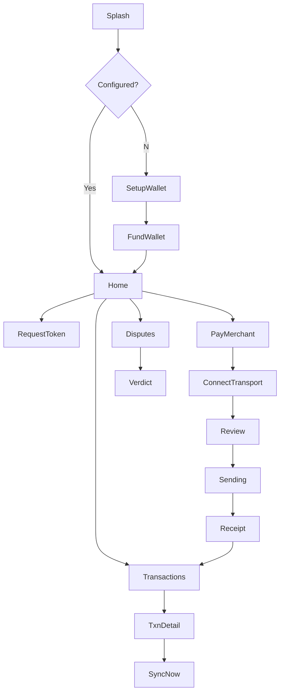

# Paron UI Flow Design

*Inspired by Google Pay, PhonePe, Paytm. Tailored to Paron's offline-first BLE payments with tokenized reservations, AI risk gating, and dispute adjudication.*

> **Source of truth for API shapes:** see [docs/API_REFERENCE.md](../API_REFERENCE.md) (generated by analysis). Key gotchas: the gateway requires RS256 JWT (PWA as-is calls no auth header); `POST /api/funding/paypal/config` is missing; server statuses are `RECEIVED/PROCESSING/SETTLED/REJECTED/HELD_FOR_REVIEW/FAILED`; local BLE states are `SENDING/ACCEPTED_OFFLINE/SEND_FAILED/SUBMITTED`; dispute rulings `INSUFFICIENT_EVIDENCE/FORGED_RECEIPT/SINGLE_PAYMENT/DOUBLE_SPEND/MULTIPLE_LEGITIMATE`.

---

## 1) Goals & Principles

- **Offline-first clarity**: Always show network state (Online/Offline/Airplane+Bluetooth), token availability, and remaining spend vs cap.
- **Trust without confusion**: Distinguish "accepted by merchant (offline)" from "settled by bank/ledger". Never call `ACCEPTED_OFFLINE` "paid/final".
- **Friction where risk is real**: For disputes/adjudication and large amounts, surface evidence. For P2P/QR, keep it one/two taps.
- **Security by design**: Never render raw JWTs. Show shortened token IDs. Mask amounts in ambiguous states.
- **Hardware aware**: Gracefully fall back to Simulator when WebBluetooth unavailable (iOS/Firefox/desktop). Merchant app remains the BLE peripheral.
- **Single source of truth**: Respect both namespaces - local UI states and server `OfflineTransaction.status` after sync/reconciliation.

---

## 2) Information Architecture

### A. Customer PWA (Installable)
```
Onboarding/Setup
├── Splash (connection check)
├── Setup Wallet (Customer ID, API Base, optional Funding API)
└── Fund Wallet (PayPal Sandbox) [optional for demo]

Home (Dashboard)
├── Token Card (status, remaining, expiry)
├── Account Card (total/available/reserved)
├── Quick Actions (Scan & Pay, Send to Merchant, Pay Contacts, Check Balance)
├── Recent Transactions (with status chips)
└── More (Token History, Disputes/AI Judge, Settings)

Pay Flow
├── Merchant selection / QR / Manual merchantId
├── Amount entry + note (optional)
├── Review & Confirm
├── Transport: Connect Merchant (BLE) OR Simulator
├── Processing (SENDING)
├── Merchant Receipt (ACCEPTED_OFFLINE / SEND_FAILED)
└── Post-payment (Queue for sync)

Sync & History
├── Sync Now (manual) + auto-sync on reconnect
├── Transaction Details (local+server state, reason codes, dispute context)
└── Token History

Disputes (AI Judge)
├── Enter two deviceTransactionIds
├── Verdict Card (ruling, confidence, winner/loser, summary)
└── Evidence list (SIGNATURE_*, SETTLED_*, SAME_TOKEN, TOKEN_STATE_AVAILABLE, TOKEN_OVER_CAP, RECEIPTS_FOUND)

Settings
├── API endpoints, User ID, Device ID (masked), Clear local data
└── Transport toggle (Simulator/BLE), About
```

### B. Merchant Android App (BLE Peripheral + Operations)
```
Home
├── Status (Advertising/Connected/Stopped)
├── Merchant Config (merchantId, API base)
└── Collected Balance (register/check)

Receive Flow (background)
├── Advertising (start/stop, permissions)
├── Frame assembly (0x50 frames)
├── Validate offer (protocolVersion/type/merchantId/token/signature/amount)
├── Accept/Reject → notify RECEIPT characteristic
└── Log (amount, txnId prefix, "Pending server settlement")

Disputes
├── AI Judge form (two txnIds) → POST /api/v1/sync/adjudicate
└── Verdict display (ruling/confidence/winner/summary)
```

---

## 3) Screen-by-Screen Flows

### 3.1 Onboarding & Setup (PWA)
| Screen | Purpose | Key Elements | Actions |
|---|---|---|---|
| **Splash** | Boot check | Logo "P" Paron, connection state chip, service worker status | Auto-advance to Home/Setup |
| **Setup Wallet** | First-time config | Customer ID, API base URL, Funding API base URL, Device ID (read-only/masked) | Save to IndexedDB `settings` |
| **Fund Wallet (PayPal)** | Optional demo credit | Amount (USD), Load PayPal checkout, status text | Load SDK, create/capture order via funding API (note: `/api/funding/paypal/config` may 404) |

*Note:* Gateway auth required for real backend calls; for local testing bypass gateway or add JWT. Current PWA has no auth header.

### 3.2 Home Dashboard (PWA) - Inspired by GPay's "Send money" + balance
| Card | Details | Behavior |
|---|---|---|
| **Header** | Connection chip: `Online — token and sync available` / `Offline — payment queue available` | Updates on `online/offline` events |
| **Token Card** | Eyebrow `OFFLINE PAYMENT TOKEN`, amount `₹X.XX` or `No token loaded`, detail `₹Y left · Expires ...`, state chip `ACTIVE/EMPTY` | From IndexedDB `tokens` (only ACTIVE not expired count). `remainingOnToken = maxAmount - spentOnToken` where spent counts `ACCEPTED_OFFLINE/QUEUED_FOR_SYNC/SUBMITTED`. |
| **Account Card** | `ACCOUNT BALANCE` `₹total` with `₹available available · ₹reserved reserved` | From `GET /api/v1/ledger/balance/{userId}` |
| **Quick Actions** | Grid: Scan QR (placeholder), Pay to Merchant, Send to Contacts, Self Transfer, Check Balance | Primary CTA: `Pay to Merchant` (matches BLE flow). |
| **Recent Transactions** | List sorted desc by `transactedAt`; each row shows merchant/target, time+txnId prefix, reason if present, status chip | After reconciliation, server states appear (RECEIVED/PROCESSING/SETTLED/REJECTED/HELD_FOR_REVIEW/FAILED). |
| **Token History** | Link to card with issued tokens + status | From `GET /api/v1/tokens/history/{userId}` |

**Status chip mapping (PWA):**
- `failed` if contains `FAILED` or `REJECTED`
- `pending` if contains `PENDING` or `QUEUED` or `ACCEPTED` or `HELD`
- else `active` (covers `RECEIVED`, `PROCESSING`, `SETTLED`)

### 3.3 Get Token (Online)
| Screen | Elements | API/Logic |
|---|---|---|
| **Request Token** | Amount (₹, default 500, 1-10000), Expiry hours (1-24, default 6), buttons `Request token online` / `Create demo token` | `POST /api/v1/tokens/gettoken` with `{userId, deviceId, amount, expiryHours}` → 201, save to IndexedDB as `status:"ACTIVE"`. `Create demo token` generates local token (demo flag) for offline testing. |

**Validation:** PWA doesn't enforce ₹500 ledger cap client-side (server may return error). Token maxAmount per request ≤ ₹10k.

### 3.4 Scan & Pay / Pay to Merchant (Offline-capable)
This mirrors GPay's "Pay to a business/merchant" with BLE transport.

| Step | Screen | Details | Actions |
|---|---|---|---|
| **1. Initiate** | Merchant/Amount | Merchant ID input (`merchant-demo-001`), Amount (₹), "Use simulator" toggle, BLE status hint | `Connect merchant` (BLE) or ensure simulator connected |
| **2. Connect Transport** | Transport Sheet | If BLE: Chrome device picker filtered by `SERVICE_UUID dabb1d77-...de01`; if Simulator: `SimulatedTransport`. Show connection status. | On connect, enable `Pay offline` button |
| **3. Review** | Review Card | Show merchantId, amount, token remaining, deviceId prefix, "Paying while offline" warning | Confirm to proceed |
| **4. Send** | Sending (SENDING) | Full-screen overlay: spinner "Sending payment to merchant...", amount, merchant | Create `transaction` object with `deviceTransactionId` (uuid), `offlineToken`, amount (2dp string), `merchantId`, `transactedAt` (YYYY-MM-DDTHH:mm:ss), `deviceId`, compute canonical string `\u0000` joined, `signCanonical` (ECDSA P-256) → attach `signature` and `publicKey` (JWK JSON string), build envelope `{protocolVersion:"paron-ble-v1", type:"PAYMENT_OFFER", transaction, payloadHash:sha256(canonical2)}`, save to IndexedDB as `state:"SENDING"`, send via transport |
| **5. Receipt** | Result | **ACCEPTED_OFFLINE**: checkmark, merchant receiptId, txnId prefix, "Accepted by merchant. It will settle after sync." **SEND_FAILED**: error icon, reason, "Try Again" (retry same txn) or "Queue for manual retry" | Update IndexedDB state; navigate to Transactions |
| **6. Post** | Transaction Detail | Show local state vs will-be-synced, BLE receipt details, hash match confirmation | Offer `Sync now` if online |

**Transport rules:**
- BLE frames: header `[0x50, totalFrames, frameIndex]` + body (≤175 bytes), max 255 frames, 20s timeout waiting for receipt notification
- Receipt must match `deviceTransactionId` and `payloadHash` exactly
- Merchant validates: protocolVersion/type/merchantId match, token non-empty, signature+deviceId present, amount>0
- PWA disables Pay if no token or (not simulator and no merchant connection)

### 3.5 Sync & Reconciliation
| Action | Flow | API |
|---|---|---|
| **Auto-sync** | On `online` event, call `autoSyncOnReconnect()` if there are txns in `ACCEPTED_OFFLINE` or `QUEUED_FOR_SYNC` | Filter, call `syncNow()` |
| **Manual Sync** | Tap `Sync now` in Transactions header | Build payload with `{deviceTransactionId, offlineToken, amount:Number, merchantId, transactedAt, deviceId, signature, publicKey}` → `POST /api/v1/sync/{userId}` returns **202** with `acceptedDeviceTransactionIds`, `acceptedCount`. Mark those as `SUBMITTED`. |
| **Reconcile** | `refreshBackend()` fetches `GET /api/v1/sync/{userId}` and maps server `status` onto local txns by `deviceTransactionId` | Updates local state to server status (`SETTLED/REJECTED/HELD_FOR_REVIEW/FAILED/PROCESSING/RECEIVED`), copies `rejectionReason`. Shows toast if any changed. |
| **History** | Transaction list shows server states after reconciliation | Use `statusClass()` for chips. `HELD` → pending (needs review). |

**Important:** 202 means queued for settlement, not final. Final outcome comes from server reconciliation.

### 3.6 Disputes / AI Judge
Matches both PWA and Merchant Android flows.

| Screen | Elements | API |
|---|---|---|
| **Dispute Resolver** | Two inputs `Device txn A`, `Device txn B`, `Resolve dispute` button | `POST /api/v1/sync/adjudicate` `{deviceTransactionIds:[a,b]}` |
| **Verdict Card** | Ruling badge (color by tone), disputeId, amountInQuestion, confidence, summary, Winner/Loser (if any), Evidence list | Rulings: `FORGED_RECEIPT`/`DOUBLE_SPEND` → failed; `INSUFFICIENT_EVIDENCE` → pending; `SINGLE_PAYMENT`/`MULTIPLE_LEGITIMATE` → active. Evidence checks: `SIGNATURE_TXN_A/B`, `SETTLED_TXN_A/B`, `SAME_TOKEN`, `TOKEN_STATE_AVAILABLE`, `TOKEN_OVER_CAP`, `RECEIPTS_FOUND`. Actions may include `REJECT_LOSER`, `SETTLE_WINNER`, `REJECT_DUPLICATE`, `HOLD_REVIEW`. `binding` false only for `INSUFFICIENT_EVIDENCE`. |

Merchant app shows a compact verdict: "AI Judge: {ruling} (conf {x.xx})\\nWinner: ...\\n{summary}".

### 3.7 Merchant Android App Flow
| Screen/Action | Details |
|---|---|
| **Setup** | Merchant ID (default `merchant-demo-001`), API base URL |
| **Register & Balance** | `POST /api/v1/ledger/merchants/register` `{merchantId}`, then `GET /api/v1/ledger/merchants/{merchantId}` → show `merchantName (registered) · collected ₹X.XX` |
| **Start Receiver** | Request BLE permissions (Android 12+), start advertising service `dabb1d77-...de01`, create GATT service with OFFER (`write/write-no-response`) and RECEIPT (`notify/read`) + CCCD |
| **Receive Payment** | On write: frame buffer until complete; parse JSON offer; validate protocol/type/merchantId/token/signature/deviceId/amount>0. If invalid → send `PAYMENT_REJECTED` with reason. If valid → send `PAYMENT_ACCEPTED` with `merchantReceiptId: "mrc-"+uuid()`, `receivedAt: Instant.now()`, update UI with amount and txnId prefix + "Pending server settlement" |
| **Disputes** | Enter two txnIds, call adjudicate, display verdict |

**Note:** Merchant app currently does structural validation only (per docs) - signature verification against token public key is a noted gap.

---

## 4) State Machine (Unified)

### Local (PWA IndexedDB `transactions`)
```
CREATED (unused) → SENDING → ACCEPTED_OFFLINE → (queued for sync)
                        ↓
                      SEND_FAILED
```
After sync submission: `ACCEPTED_OFFLINE|QUEUED_FOR_SYNC` → `SUBMITTED` (on 202). Then reconciliation overwrites with server status.

### Server (`OfflineTransaction.status`)
```
RECEIVED → PROCESSING → SETTLED
                    ↓
                  REJECTED
                    ↓
                HELD_FOR_REVIEW
                    ↓
                  FAILED
```
(reasons via `rejectionReason` prefixes: `TOKEN_INVALID_*`, `FRAUD_HOLD: ...`, `FRAUD: ...`, `PROCESSING_ERROR: ...`)

### Fraud decisions
`APPROVE` / `HOLD_FOR_REVIEW` / `REJECT` (from `FraudCheckResponse.decision`). `HOLD_FOR_REVIEW` reasons include `model_unavailable`, `low_confidence`, `score_in_review_band`, `low_information_new_device`. `REJECT` can be `hard_rule_hit` or `score_above_threshold`.

---

## 5) UI Component Specs

| Component | Style (inspired by GPay/PhonePe) | Notes |
|---|---|---|
| **Cards** | Rounded corners, subtle shadow/border, white background | `.card` in current CSS |
| **Chips** | Pill shape: `active` (green-ish), `pending` (amber/orange), `failed` (red), `muted` | Match `statusClass()` |
| **Buttons** | Primary filled, secondary outlined, disabled state | `.actions` with primary/secondary |
| **Keypad** | Numeric keypad for amount entry (like PhonePe) | Large digits, quick amounts ₹100/₹500/₹1000 |
| **QR Scanner** | Fullscreen viewfinder with frame, flash, gallery upload | For "Scan & Pay" |
| **PIN/Confirmation** | Amount prominent, merchant/recipient, token remaining, "Pay" CTA | Since UPI PIN not in this flow, use confirmation modal + transport connection |
| **Status Screens** | Success checkmark animation, Pending spinner with note, Failure with reason + Retry | Match "Processing/Loading, Success/Failure/Pending" from design doc |
| **Verdict Card** | Evidence accordion with pass/fail dots | Show all `evidence[]` entries |

---

## 6) Navigation Map



---

## 7) API Binding Matrix (PWA ↔ Backend)

| Feature | Endpoint | Method | Notes |
|---|---|---|---|
| Get token | `/api/v1/tokens/gettoken` | POST | Returns JWT in `token` (do not display full) |
| Token history | `/api/v1/tokens/history/{userId}` | GET | Filter `ACTIVE` |
| Balance | `/api/v1/ledger/balance/{userId}` | GET | Show available/reserved |
| Sync queue | `/api/v1/sync/{userId}` | POST | 202, idempotent by `deviceTransactionId` |
| Sync status | `/api/v1/sync/{userId}` | GET | Reconcile states |
| Adjudicate | `/api/v1/sync/adjudicate` | POST | AI Judge |
| Merchant register/balance | `/api/v1/ledger/merchants/*` | POST/GET | Used by merchant app; PWA could use later |
| PayPal config/orders/capture | `/api/funding/paypal/*` | GET/POST | Funding API base; `/config` missing |

---

## 8) Implementation Recommendations

### PWA Improvements
1. **Auth**: Add JWT acquisition (login) or dev mode toggle to attach `Authorization: Bearer <token>`. Gateway requires it.
2. **Fix PayPal config**: Add endpoint or hardcode for demo / handle 404 gracefully.
3. **State reconciliation**: When server status differs, show "Updated from server" toast and detailed reason.
4. **Error handling**: Map `errorCode` values (e.g., `RESERVE_LIMIT_EXCEEDED`, `TOKEN_ALREADY_USED`, `BATCH_TOO_LARGE`) to user-friendly messages.
5. **Offline UX**: Disable network-dependent actions when offline; show queue count.
6. **Security**: Never log full tokens/signatures; mask in UI.
7. **Amount formatting**: Consistent ₹ formatting, 2dp.

### Merchant App Improvements
1. **Token verification**: Verify ECDSA signature against stored/public key or fetch public key (align with signed receipts).
2. **Exposure limits**: Enforce per-merchant/device caps locally.
3. **Better UX**: Amount large, status prominent, sound/vibration on accept.
4. **Connectivity**: Handle Bluetooth on/off, reconnect, permissions gracefully.

### Shared
1. **Protocol versioning**: Keep `paron-ble-v1` strict.
2. **Idempotency**: Always use same `deviceTransactionId` on retry.
3. **Observability**: Correlation IDs in logs/UI where possible.
4. **Testing**: Use Simulator mode for demos; document airplane mode steps clearly.

---

## 9) Quick Demo Script (Aligned)
1. **Setup**: Open PWA (HTTPS), set API/Funding URLs, Customer ID. (Get JWT or bypass gateway.)
2. **Fund/Token**: Create test account or use PayPal (if working), request token online (₹500, 6h).
3. **Merchant**: Start Android merchant app, register/check balance, start advertising.
4. **Pay Offline**: On PWA turn off network, enable BT, connect merchant, pay ₹125 → `ACCEPTED_OFFLINE`, merchant shows "Pending server settlement".
5. **Sync**: Reconnect network, `Sync now` → 202 submitted, reconcile to see `SETTLED`/`HELD_FOR_REVIEW`/`REJECTED`.
6. **Dispute**: Use two txn IDs in AI Judge (PWA or merchant) to see verdict + evidence.

---

## Appendix: Wireframe Notes (Textual)
- **Home**: Header with connection chip → Token card → Account card → Quick Actions grid (4-5) → Recent Transactions list → Footer links
- **Pay Flow**: Stepper (Merchant→Amount→Review→Send→Receipt), large amount display, numeric keypad
- **Receipt**: Success animation, details card, primary "Done", secondary "View Transaction"
- **Verdict**: Color-coded header, summary, evidence list with checkmarks/X, actions if any

This design preserves Paron's existing API contracts and PWA/merchant behavior while presenting a cleaner, payment-app-like UX.